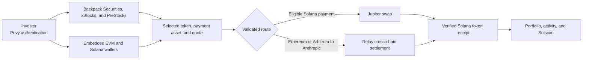

<p align="center">
  <strong style="font-size: 18px;">Eleven Capital:</strong>
  <span style="font-size: 18px;">Onchain stocks across networks, designed for Seeker</span>
</p>

<p align="center">
  
</p>

<p align="center">
  
  
  
</p>

Eleven Capital is a mobile wallet for Solana markets and creator communities. It gives people one place to explore tokenized stocks and tokens, follow charts, and see their balances, holdings, and activity. Finding an asset and keeping track of it should feel like one experience, not a series of trips between a market app and a wallet.

Community brings people closer to the tokens they care about. A creator can give a token its name, artwork, and story. A supporter can open it from a QR code, follow its market page and their position, and find the conversation around it. Eleven is designed to keep that connection visible after the token is discovered. 


Meteora gives creators a way to launch those tokens. Its Dynamic Bonding Curve lets early trading establish a price, instead of requiring a traditional liquidity pool on day one. Eleven turns the launch choices, such as supply, trading fee, and graduation target into a guided mobile flow. The project’s prepared transaction code uses Meteora’s SDK to create the token and its virtual pool, request a wallet signature, and verify the result.


As people trade, the price moves along the curve and SOL builds up in the pool. When the chosen target is reached, curve trading ends and the token becomes eligible to move into a DAMM v2 pool for ongoing trading. Eleven already shows live Meteora tokens and market data in the app. The creator launch and purchase journey can currently be explored locally; real mainnet transactions are in the codebase but are not yet enabled in the Android build.

Explore Eleven Capital at [elevencapital.vercel.app](https://elevencapital.vercel.app).

Designed for Solana Seeker.

## How Eleven Capital uses Privy

Privy handles sign-in, the embedded wallets, and signing. Each account can have an EVM wallet and a separate Solana wallet. Eleven Capital receives public addresses and an authenticated session to prepare wallet actions; it does not hold the user's private keys.

The EVM address works across supported EVM networks, but balances remain separate on each chain. ETH on Ethereum is not ETH on Arbitrum, even when both use the same address. The Solana wallet has its own address for SOL and Solana tokens. The Add screen shows the address and network to use when receiving funds.

A wallet session is shared across Home, Stocks, Portfolio, and the order flow. Before a transfer or purchase, Eleven Capital binds the action to the account, selected network, amount, and destination. After submission, the app retains the transaction identity so it can check the same action again if the connection or app session is interrupted.

Android's device credential guards access when the app is reopened. Privy remains responsible for wallet credentials and signing material. Server-side market and transaction services never need a recovery phrase or private key.

<p align="center">
  <!-- Add the wallet and receive screenshots here.
  
  -->
</p>

<p align="center">
  <!-- Add another Privy wallet screenshot here if needed.
  
  -->
</p>

## How Eleven Capital works



## Eleven Capital’s Meteora architecture

Eleven Capital is the mobile home for a creator token from its first launch to an established community. A creator designs the token and its launch in Eleven; Meteora’s Dynamic Bonding Curve (DBC) handles on-chain price discovery; and the creator’s wallet signs the launch on Solana. Supporters can discover the token, buy it, see their position, and join its conversation in the same app. When the launch graduates, the token keeps its identity and Community page while trading moves to Meteora DAMM v2.

```text
Creator designs token in Eleven
        ↓
Wallet signs → Meteora DBC virtual pool → Bonding-curve trading
                                            ↓ quote threshold reached
                                      DAMM v2 liquidity pool

Supporter scans QR → Token page → Wallet-signed buy → Tokens + Community → Holder chat
```

## Creator launch

The creator chooses artwork, a name, ticker, description, and community links. Eleven stores the artwork and token metadata, then presents the launch economics in understandable terms: the starting valuation, curve shape, trading fees, graduation target, token allocation, vesting, and post-graduation liquidity ownership. A simple choice such as *Flat*, *Exponential*, or *Long* is an Eleven design preset translated into Meteora’s configurable curve points—not a separate type of Meteora contract. DBC supports a starting price and up to 16 curve segments. [Meteora’s curve documentation](https://docs.meteora.ag/core-products/dbc/universal-curve)

Eleven validates those choices against a DBC launch configuration and prepares the Solana transaction. The creator reviews and signs it with their wallet. The resulting token mint and DBC pool are the durable identifiers for the launch; the token then appears under the creator’s *Launched Tokens*, with a QR code that opens its Eleven page. The configuration also records how fees, creator allocations, and migrated liquidity are distributed, so those terms are established before trading begins. [Meteora’s launch-configuration documentation](https://docs.meteora.ag/core-products/dbc/launch-configurations)

## From bonding curve to DAMM v2

At launch, the token trades against a DBC *virtual pool*, paired with SOL. Each buy contributes SOL to the pool and moves the price along the creator’s chosen curve; sellers trade against that same pool. Eleven reads the pool’s on-chain price, activity, reserves, and progress to power the token’s chart and launch details. Every buy or sell is reviewed and signed by the user’s wallet, and Eleven updates the position after the Solana transaction is confirmed. [Meteora’s DBC overview](https://docs.meteora.ag/core-products/dbc/what-is-dbc)

Graduation is determined by the pool’s **accumulated quote reserve**, not merely by a displayed market-cap figure. When the configured SOL threshold is reached, normal DBC swaps stop. A migration process then uses the accumulated SOL and allocated tokens to establish a DAMM v2 pool near the price discovered on the curve, applying the configured liquidity locks, vesting, and ownership. Eleven tracks that transition and routes subsequent trading and market data to DAMM v2 once the pool is live. The mint address, QR link, token page, and community remain the same. [Meteora’s migration documentation](https://docs.meteora.ag/core-products/dbc/migration-and-liquidity)

## How the community connects

The Solana mint address is Eleven’s common key for the token’s artwork, launch record, market data, wallet balances, QR link, and chat room. Scanning a creator’s QR opens that token’s page; scanning alone does not imply ownership. After a supporter buys, the confirmed wallet balance places the token in *Tokens* and the creator-token entry in *Community*. Creators see their launches separately from tokens they have bought.

Chat is the social layer around that on-chain ownership. A wallet-authenticated creator can participate in their token’s room, while supporters can post when their wallet holds the token. Others can discover the token and read the conversation. This keeps messages fast and social without putting chat content on-chain, while Solana remains the source of truth for ownership.

In short: **Eleven designs the experience and connects the community; the wallet authorizes each financial action; Meteora DBC runs the launch; DAMM v2 provides the graduated market; and Solana records the token and its ownership.**

<p align="center">
  <!-- Add the stock catalog and purchase screenshots here.
  
  -->
</p>

## Transaction verification and settlement

A purchase is not complete because someone tapped Purchase, saw a success animation, or received a provider status. Eleven Capital records the reviewed order, the wallet action, and the resulting transaction identifiers. The backend checks the source-chain action and the required Solana token credit before it records completion.

The same-chain path validates the signed Solana swap and checks the received mint and amount. The cross-chain path follows the source payment, Relay route, and destination receipt. A completed order links to its actual Solana transaction signature so the onchain transfer can be opened on Solscan. An unavailable, expired, or mismatched route is not treated as a successful investment.

Market charts provide context; the executable quote determines the actual trade terms. Backpack Securities, xStocks, and PreStocks describe different legal and economic products. A token balance proves ownership of that token on Solana, while issuer documentation defines any backing, redemption, or shareholder rights.

<p align="center">
  <!-- Add a transaction or architecture image here.
  
  -->
</p>

## Wallet activity and portfolio

Home brings wallet actions together: incoming transfers, outgoing transfers, stock purchases, and sales. A row can show its time, direction, asset, and dollar value when reliable pricing is available. Portfolio shows supported holdings with their token quantity and estimated value. A missing price remains distinct from a zero balance.

Balances come from the connected wallet addresses and their chains. Pending orders remain separate from holdings until the destination receipt is verified. Explorer links are formed from validated chain and transaction identifiers rather than arbitrary URLs supplied by a quote provider.

Stocks combines issuer lists, search, charts, and order entry. Signal displays reported congressional disclosures and related news, with source links so a filing can be read independently.

<p align="center">
  <!-- Add the portfolio and activity screenshots here.
  
  -->
</p>

## Order recovery and resilience

The purchase journal separates a user's intent from each network action. Once a transaction is submitted, the app retains its identity and resumes checking its status after an interruption. A retry of status verification does not authorize another payment.

The backend rejects mismatched wallets, expired quotes, unsupported routes, duplicate submissions, and receipts for the wrong token or amount. An unresolved source payment is not assumed to have failed merely because a network request timed out. Cross-chain orders need this distinction because a confirmed deposit cannot be rolled back by a failure on the destination chain.

## Run locally

Eleven Capital needs Node.js 22.14 or newer within Node 22, npm, Java 17, Android SDK 35, and an Android device or emulator. Configure a Privy application for the Android package and sign-in redirect scheme.

Start the backend:

```bash
cd backend
npm ci
npm run dev
```

The development API listens on `127.0.0.1:8787`. In the repository root, place your Android SDK path and public Privy app and client identifiers in untracked `local.properties`, or pass the identifiers through Gradle properties or environment variables. Then build the app:

```bash
./gradlew -PandroidBuild=true -PmarketDataUrl=http://127.0.0.1:8787 :app:assembleDebug
adb reverse tcp:8787 tcp:8787
```

The loopback backend URL is for local device testing through ADB. APK packaging requires a backend URL; a deployed build needs HTTPS. `app/build.gradle.kts` rejects an ordinary HTTP endpoint outside loopback.

## Configuration

Public Privy identifiers may be supplied as `privyAppId` and `privyClientId` Gradle properties, `PRIVY_APP_ID` and `PRIVY_CLIENT_ID` environment variables, or values in untracked `local.properties`. The Android app must not contain a Privy app secret or a trading-provider API key.

The backend reads `JUPITER_API_KEY`, `RELAY_API_KEY`, and `LIFI_API_KEY` when the relevant provider requires them. It can load a Jupiter key from an owner-only local file; [server-config.ts](backend/src/server-config.ts) defines the permission and format checks. Keep keys, wallet material, local properties, APKs, and build output outside Git.

## Useful commands

```bash
cd backend && npm run dev     # Start the local API and market feed
cd backend && npm run build   # Type-check and bundle the backend
cd backend && npm test        # Run backend tests
./gradlew :core:test          # Run shared domain tests
./gradlew -PandroidBuild=true :app:compileDebugKotlin
```

The Android source lives in `ElevenApp.kt`, `auth/`, `data/`, `purchase/`, `screens/`, `ui/`, and `wallet/`. Backend routes and validation live in `backend/src/`; their tests live in `backend/test/`. The detailed contract and settlement model remains in [SMART_CONTRACTS.md](SMART_CONTRACTS.md).

## Security and current scope

Executable routes are limited to independently validated same-chain Solana swaps and the pinned Anthropic Relay route funded with ETH on Ethereum, or ETH or USDC on Arbitrum. A catalog listing or a fallback quote is not permission to trade on every network. Availability still depends on the connected wallet, amount, gas, liquidity, and provider response. A funded Anthropic purchase has not yet been rehearsed end to end on mainnet.

Debug builds include local SPCXx and Nike purchase flows for reviewing the mobile interface. They do not broadcast a new purchase or change the Privy balance; their explorer links open earlier transactions. These flows are separate from the live purchase coordinator and are disabled outside debug builds.

Tokenized securities have issuer-specific eligibility and legal terms. Review the issuer's documentation and the live order before funding a wallet or authorizing a trade.
